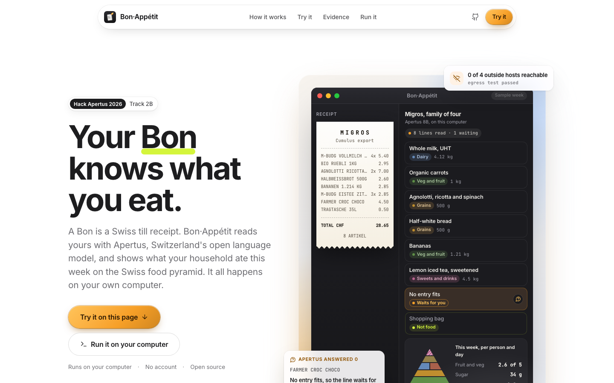

# Bon·Appétit

**Your Bon knows what you eat.** Drop in a Swiss till receipt. Apertus reads the shorthand, the federal Swiss food database supplies the numbers, and it all runs on your own computer.



Bon·Appétit reads Swiss supermarket receipts and shows a household what it actually eats, measured against the Swiss food pyramid. It runs on the household's own computer. Apertus v1.5 reads the receipt shorthand, a federal food database supplies the numbers, and nothing leaves the machine.

Website and live demo: https://kinnuworks.github.io/bon-appetit/ · Technical report: [technical_report.md](technical_report.md) ([PDF](DhirajKavuri_Report.pdf)) · Demo video: {{VIDEO}}

## The problem

A Swiss till receipt says `M-BUDG VOLLMILCH UHT 1L`, `QP GRUY.RAPE 200G` or `NATURAPLAN BIO RUEBLI 1KG`. Lines are cut short, mix German, French and Italian, and use shop-brand codes. The Migros Cumulus export has no barcodes, and Coop only gives PDFs. A lookup table or fuzzy text match cannot turn these lines into food, so households, dietitians and prevention programmes cannot use the purchase data they already have.

Purchase histories also reveal health conditions, religion and money. Under the revised Swiss data protection act, health data is sensitive personal data, so this is a job for a model that runs where the data is.

## What it does

1. **Reads the receipt.** Migros Cumulus CSV, the text of a Coop PDF receipt, or pasted text. Prices, quantities, pack sizes (`6X1.5L` becomes 9 litres) and non-food lines are handled by rules, not by the model.
2. **Writes out each line with Apertus.** One call per line returns a plain description, the language, whether it is food, and a generic German food-table name.
3. **Finds candidates.** Lexical search plus Swiss multilingual embeddings derived from Apertus ([andreasmartin/apertus-v1.1-swiss-embed-0.4b-bidir](https://huggingface.co/andreasmartin/apertus-v1.1-swiss-embed-0.4b-bidir)) search the 1,145 foods of the [FSVO Swiss Food Composition Database](https://naehrwertdaten.ch). French and Italian lines reach German food names this way.
4. **Picks or abstains with Apertus.** A second call chooses one candidate by its list number, or none. A line with no good match goes to a review queue with a question.
5. **Cross-checks the pick against Apertus's own estimate.** A third call asks Apertus what the product contains per 100 g. That estimate is never shown or used as a number: it only decides which of the top candidates fits best. The model's own pick gets a head start and stays unless its federal record is clearly further from what the model expects. This step cuts the energy error from 123 to 102 kcal per 100 g.
6. **Checks the pick in code.** The food layer rejects picks that break physical rules: a line sold in litres cannot be a solid cheese, energy must agree with macronutrients (Atwater), and pack sizes must be household sizes. A small glossary of Swiss food words (Rüebli, Nüsslisalat, Peperoni) covers words the model misreads.
7. **Adds it up.** Code computes grams per adult per day for each group of the Swiss food pyramid, plus sugar, salt and saturated fat, and compares them with reference amounts derived from the Swiss Society for Nutrition portions.
8. **Suggests one swap**, in German, French, Italian or English. Apertus writes the sentence; numbers enter only through placeholders that code fills, so the model cannot change them.

Apertus never writes a nutrient value that you see. Every number comes from the FSVO record of the chosen food.

## Results

**At a glance.** 160 real Swiss products, label hidden, receipt-style line in. Bon·Appétit is off by more than 100 kcal per 100 g on 34% of them; plain text matching on 54%. Its typical error is 102 kcal per 100 g, against 122 for Apertus guessing with no source and 171 for text matching. It leaves 8% of lines for you to confirm instead of guessing. The receipt lines are produced from real product names by rules we wrote (docs/receipt_rules.md), so real tills may differ.

160 real Swiss products from Open Food Facts, label hidden, receipt-style line in, compared with the printed label (Errors are per 100 g against printed Open Food Facts labels. Within-20% uses max(20% of label, 20 kcal).).

| Method | kcal error per 100 g (95% CI) | Off by >100 kcal | Sugar error, g | Salt error, g | Food group right | Abstains |
|---|---|---|---|---|---|---|
| Fuzzy text match | 171 (151 to 195) | 54% | 13.6 | 0.85 | 27% | 0% |
| Swiss embeddings only | 194 (171 to 219) | 62% | 17.9 | 0.85 | 27% | 0% |
| Search only, no Apertus pick (ablation) | 153 (129 to 177) | 49% | 12.3 | 0.92 | 38% | 5% |
| Apertus alone, guessing (no source) | 122 (104 to 144) | 44% | 10.3 | 0.69 | n/a | 6% |
| Hybrid, Apertus pick only | 123 (102 to 145) | 39% | 10.7 | 0.69 | 49% | 8% |
| Bon·Appétit: pick plus Apertus cross-check | 102 (84 to 118) | 34% | 9.0 | 0.68 | 50% | 8% |
| Label-informed ceiling (best FSVO food) | 12 (10 to 15) | 0% | 1.2 | 0.66 | 61% | 0% |

**Held-out check.** The cross-check has two settings (how many candidates it looks at, and how strongly it favours the model's own pick). They were chosen on the odd-numbered products only; this table scores every method on the even-numbered products, which played no part in that choice.

| Method, held-out half only | n | kcal error (95% CI) |
|---|---|---|
| Fuzzy text match | 80 | 162 (131 to 194) |
| Search only, no Apertus pick (ablation) | 76 | 144 (115 to 176) |
| Apertus alone, guessing (no source) | 74 | 128 (100 to 157) |
| Hybrid, Apertus pick only | 73 | 120 (92 to 152) |
| Bon·Appétit: pick plus Apertus cross-check | 73 | 94 (71 to 124) |
| Label-informed ceiling (best FSVO food) | 80 | 11 (9 to 14) |

| Method, on the products the hybrid answered | n | kcal error (95% CI) | Off by >100 kcal |
|---|---|---|---|
| Fuzzy text match | 148 | 172 (149 to 197) | 53% |
| Swiss embeddings only | 148 | 196 (170 to 221) | 62% |
| Search only, no Apertus pick (ablation) | 148 | 153 (129 to 176) | 50% |
| Apertus alone, guessing (no source) | 140 | 116 (98 to 137) | 41% |
| Hybrid, Apertus pick only | 148 | 123 (102 to 145) | 39% |
| Bon·Appétit: pick plus Apertus cross-check | 148 | 102 (84 to 118) | 34% |
| Label-informed ceiling (best FSVO food) | 148 | 12 (10 to 15) | 0% |

Running the same energy check over all 86,517 Swiss products on Open Food Facts flagged 3,035 (4%) whose printed calories contradict their own macronutrients; 433 look like kilojoules typed as kilocalories. The list is in `eval/off_energy_flags.csv`. The same rule flags none of the 1,046 non-alcoholic foods in the federal FSVO database, so it is not firing at random: the inconsistencies are in crowd-sourced entries, where a volunteer typed the label.

**Paired comparison on the same products** (Bon·Appétit minus the other method; negative means Bon·Appétit is closer to the label). Against text matching: -71 kcal (95% CI -98 to -44, n=148). Against the Apertus pick without the cross-check: -22 kcal (95% CI -40 to -4, n=148), so the cross-check helps. Against Apertus guessing alone, on the held-out half: -26 kcal (95% CI -54 to -1, n=68); on the full set the difference is -13 kcal (95% CI -31 to +4, n=140) and not statistically clear. The firm claims are therefore the gains over text matching and over the plain pick, plus the held-out gain over guessing; the full-set gap over guessing is a trend.

**Household view.** Over 200 simulated weekly baskets of 20 products, the food-pyramid shares are off by 7.3 percentage points per group on average, against 8.5 for text matching. Errors on single products partly cancel over a week, so the gap is smaller here than per product.

The ceiling row is the best any link to a generic FSVO food can do; the gap between it and the hybrid is linking error, which is where the next work goes.

## Value and cost

Measured on an Apple M5 laptop with 16 GB, Apertus v1.5 8B Q4_K_M through Ollama, four requests in parallel: 47.1 seconds per receipt line for all three Apertus calls together, including queueing. A weekly receipt of 20 food lines therefore takes about 15.7 minutes on one laptop, with no subscription and no per-request fee. Electricity for 1,000 such receipts is about CHF 2.36 (laptop at 30 W, 20 food lines per receipt, CHF 0.30 per kWh, measured seconds per line with 4 parallel requests). The laptop run is a demonstration of the sovereign setup, not of speed. Throughput on a server GPU or a Swiss cloud endpoint was not measured here; that is the path for a retailer-scale service and the first thing a pilot would measure.

Per receipt line the run used about 581 input and 107 output tokens over three Apertus calls. At the measured laptop rate that is about 76 lines per hour per laptop with four requests in parallel. Server throughput was not measured.

## Who uses it, and how it gets adopted

1. **A household, today.** Export the Cumulus receipts as CSV or paste a Coop receipt, run `make run`, and read the week. No account, nothing uploaded.
2. **A retailer's loyalty app.** The container runs on the retailer's own servers next to the purchase data it already holds. The retailer has barcodes for its own sales; the model matters for the barcode-less exports and for receipts from other shops that customers bring in.
3. **A dietitian, home-care service or insurer prevention programme.** With the client's consent, start a conversation from what was actually bought instead of a food diary written from memory. The purchase data never reaches the insurer.

A first pilot needs 20 households who consent to share four weeks of receipts, a dietitian to review the reference amounts, and one outcome measured from the receipts themselves: the change in the vegetables-and-fruit share. FoodCoach (NCT05597969) is the reference design for such a trial; Bon·Appétit does not claim an effect yet.

The code stays open (Apache-2.0). Paid work, if any, sits around it: running the service for a retailer or a prevention programme, and keeping the Swiss food glossary and the Open Food Facts corrections current.

## Run it

From the repository root:

```bash
make run      # builds the app image, re-scores the stored evaluation, then serves http://localhost:8080
```

`make run` reaches the model through the template variables, so a judge can point it at any Apertus server:

```bash
export LLM_NAME=swiss-ai/Apertus-v1.5-8B          # the model name your server expects
export LLM_BASE_URL=http://host.docker.internal:8000/v1   # a server on your host; not localhost inside Docker
export LLM_API_KEY=...
make run
```

`LLM_NAME` must match the name your server serves (for vLLM, the `--served-model-name` or the Hugging Face id). The app checks the endpoint at startup and prints a warning with a hint if it cannot reach it. Without a model the site and the stored evaluation still work; only live reading needs one. Requests use JSON mode; if a gateway rejects `response_format`, the client retries without it.

Other targets:

| Target | What it does |
|---|---|
| `make local` | App plus a bundled llama.cpp server with Apertus v1.5 8B (Q4_K_M GGUF, CPU). Downloads the model file once. |
| `make airgap` | The same two containers on a Docker network with no route outside. The app first runs an egress test and refuses to start if any outside host answers. |
| `make eval` | Re-scores the stored predictions without a model and checks the result hash in `eval/results.sha256`. |
| `make test` | Unit tests. |

## Deployment target

**b) Air-gapped**, and **a) on-premise**. The model, the food database and the app run on one machine. Build time needs the internet once (Docker images, Python packages, the embedding model, which is baked into the image, and the GGUF file for `make local` and `make airgap`); runtime needs none. The Open Food Facts dump is needed only to rebuild the evaluation set (`scripts/fetch_off.py`). A Swiss cloud endpoint (c) works through `LLM_BASE_URL` for organisations that prefer it.

## Repository

| Path | What it is |
|---|---|
| `src/bonappetit/` | The package: receipt parser, catalogue search, food layer, Apertus client with replay cache, linker, ledger, local server, egress test |
| `eval/` | Evaluation set builder, runner, scorer, stored predictions and results |
| `data/fsvo.csv` | The FSVO database as one tidy table (1,145 foods) |
| `data/llm_cache.jsonl` | Every Apertus request and answer from the evaluation, for replay |
| `site/` | The website and in-browser demo |
| `scripts/` | Data and model download, demo builder |
| `tests/` | Unit tests |
| `technical_report.md` | Architecture, evaluation, limits, lessons on Apertus |

## Data and licences

Code: Apache-2.0. Documentation: CC-BY-4.0. FSVO Swiss Food Composition Database V6.5: free reuse with attribution (Federal Food Safety and Veterinary Office). Open Food Facts: the evaluation set and the energy-check list contain information from Open Food Facts under ODbL 1.0 and stay under ODbL; the full dump is never redistributed. File by file: [DATA_LICENSES.md](DATA_LICENSES.md). No personal data is used anywhere.

## Prior work

TooSweet (Open Food Hackdays 2018) ranked Migros Cumulus purchases by sugar. ETH Zurich's FoodCoach trial (NCT05597969) and Receipt2Nutrition studied nutrition from digital receipts. Bon·Appétit adds multilingual reading of raw receipt lines with an open Swiss model, abstention, a symbolic check, and an evaluation against printed labels that anyone can re-run.

## What the evaluation does and does not show

- The food glossary and the receipt-shortening rules were written before the evaluation set was built, from the first eight demo lines, not tuned on the test products.
- The daily reference amounts are derived by hand from SGE portion advice (`docs/food_layer.md`) and are illustrative until a dietitian reviews them.
- Lines without a pack size get a default amount per food group, flagged as estimated in the output (`pack_size_estimated`).
- The model file is a community conversion, not an official swiss-ai release: `Colby/apertus-v1.5-8b-text-Q4_K_M-GGUF`, SHA-256 a037df8d87ff6caacee794ee85f55342f2152e0d359b7389033300c3bee5f299.

## Not medical advice

Bon·Appétit describes purchases, not what each person eats, and refers to the Swiss dietary recommendations. It does not diagnose or treat anything.

---

<details><summary>Track 2B brief from the Hack Apertus template</summary>

# Track 2 B: Own Project

Bring your own idea and build a working Apertus prototype that tackles a problem you care about — any domain, any use case. The project must be new, started within the hackathon period.

Submissions must use the Apertus model family.
For Track 2 this means that submitted solutions must be built with Apertus. Other open-weights models can be used to support development, e.g. as automatic judges during evaluation. Their role must be clearly described in the submission report.

💬 In case you have questions, join the conversation on [Discord](https://discord.gg/hack-apertus) or send an email to “hello@hackapertus.ch”

---

## 🔧 Resources & Tools

Check our resources & tools page for detailed information:
https://hackapertus.notion.site/resources-tools

| Models           | URL                                      |
|------------------|------------------------------------------|
| Apertus v1.5 8B  | [huggingface.co/swiss-ai/Apertus-v1.5-8B](https://huggingface.co/swiss-ai/Apertus-v1.5-8B)  |
| Apertus v1.5 70B | [huggingface.co/swiss-ai/Apertus-v1.5-70B](https://huggingface.co/swiss-ai/Apertus-v1.5-70B) |


## Target architecture (mandatory)

Whatever you build in Track 2B must be deployable in one of these three architectures:

- **a) On-premise** — on the organisation's own infrastructure, under its own administration.
- **b) Air-gapped** — with no external network connection at runtime.
- **c) Sovereign Swiss cloud** — on a cloud platform operated in Switzerland, under Swiss jurisdiction, with Swiss data residency.

---

## Data

The `data/` directory must not exceed 100 MB.

---

## 📦 Submission Requirements & Deliverables

❗️ Submissions are not handled on Devpost but via this URL only:
http://hackapertus.ch/online-hack/submissions

The submission must: 
1. follow the template repo and include all prerequisite files and definitions
2. follow the specified input/output formats
3. run in a Docker container, launched with `make run` from the root of the project
4. run end-to-end when judges try to run it

### Git repo (URL)
- Create your repo from this template (**Use this template**) and work in the `track_2b/` challenge directory. Delete the other track challenge directories.
- Keep `track_2b/` as it is: don't rename it or move its files.
- Set the repo to PUBLIC (Settings --> Collaborators --> Manage Visibility)
- Submit the URL of YOUR Git repo.

### Technical Report (pdf)
- Update [technical_report.md](technical_report.md) in this repository with all the details for your submission.
- Upload a pdf of your technical report to this directory, named as `TeamName_Report.pdf`.
- Format: pdf, max. 6 pages w/o references
- Submit the pdf of the technical report.

### Demo video (URL)
- Max. 2 min demo video of your prototype

### Dataset (URL) - optional, depending on your project
Submitted datasets must comply with our guidelines for responsibly sourced datasets.

- Create a user account on Hugging Face
- Clone our dataset template on Hugging Face: https://huggingface.co/datasets/HackApertus/online_hack_template
- Complete the dataset card with all required information
- Upload your dataset. It should consist of the following components:
    - evaluation dataset (i.e. individual test cases)
    - model response dataset (i.e. the model response to each test case)
    - metadata file (i.e. additional information about each test case; where relevant, this file must contain instance-level licensing information) 
- Make sure your dataset access control is set to PUBLIC
- Provide the URL of _your_ data set


---

## ⚖️ Judging Criteria

1. Purposeful use of AI
2. Technical rigour
3. Value, cost & scalability
4. Sovereign deployability
5. Implementation feasibility

Judges use a Scale 0–5 per dimension.

---

## Support

**Licensing requirements**
Please check our Terms & Conditions (6. What you build is open source):
https://hackapertus.ch/terms-and-conditions

## FAQ
💡 https://hackapertus.ch/faq

## Contact
💬 In case you have questions, join the conversation on Discord or send an email to “hello@hackapertus.ch”

</details>
